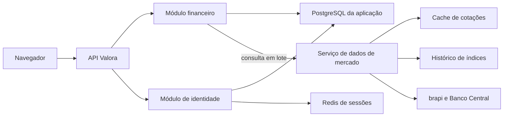

# Valora | Viabilidade de microserviços

Análise de 18 de novembro de 2026, sobre o commit `9e4a3af`. Avaliação estática das dependências, entidades, transações e infraestrutura existentes. O repositório contém um único artefato Maven, uma aplicação Spring Boot e uma base PostgreSQL. Não há dados de volume, latência, tamanho da equipe ou custo operacional que permitam estimar ganhos de escala ou prazo de migração.

**A divisão é tecnicamente viável. Para o estágio atual, recomendo organizar o Valora em módulos de domínio e começar uma eventual extração pelo serviço de dados de mercado.** Operações, posições e provisões de proventos devem continuar juntas na primeira etapa. Essa composição mantém a confirmação de uma operação financeira dentro de uma transação local.

A recomendação considera a plataforma ainda em construção e o fluxo web financeiro ainda baseado em exemplos locais. Se a finalidade principal for aprender arquitetura distribuída, uma primeira versão com dois serviços também é justificável. O relatório apresenta esse caminho com limites e critérios de aceite.

## Dependências que definem os limites

| Fluxo atual | Dependência observada | Impacto da distribuição |
| --- | --- | --- |
| Cadastro | UserService grava usuário e carteira Principal na mesma transação. | Separar identidade exige tratar conta criada com carteira ainda ausente, inclusive em repetição da requisição. |
| Compra e venda | TransactionService resolve titularidade, consulta ativo e grava operação e posição em uma transação. | Separar operação e posição introduziria um intervalo em que o extrato e o saldo poderiam discordar. A validação da venda precisa usar o estado autoritativo da posição. |
| Provento | ProventService consulta posições históricas pelo histórico de operações, grava o evento e cria provisões por carteira. | Um serviço separado precisa receber histórico confiável, lidar com eventos atrasados e reprocessar direitos após lançamentos retroativos. |
| Resumo | PortfolioService lê posições, proventos pagos e séries de índices e chama QuoteService. | A consulta pode depender de vários serviços. A resposta precisa registrar o instante e a qualidade dos dados utilizados. |
| Rebalanceamento | SmartRebalancingService usa resumo, metas, catálogo e cotações. | Um serviço próprio teria várias dependências e pouca autonomia no estágio atual. |
| Autenticação | SecurityFilter valida JWT e consulta UserRepository em cada requisição com token. | Copiar o filtro para cada serviço exigiria acesso ao banco de identidade ou consulta remota por requisição. |
| Importação de proventos | ProventSyncService descobre ativos em transações e posições antes de consultar a brapi. | O importador precisa receber a lista de ativos de interesse por contrato, sem ler tabelas financeiras de outro serviço. |

Fontes. [Cadastro](src/main/java/com/rick1135/Valora/service/UserService.java) · [Operações](src/main/java/com/rick1135/Valora/service/TransactionService.java) · [Proventos](src/main/java/com/rick1135/Valora/service/ProventService.java) · [Consulta histórica](src/main/java/com/rick1135/Valora/repository/TransactionRepository.java) · [Resumo](src/main/java/com/rick1135/Valora/service/PortfolioService.java) · [Rebalanceamento](src/main/java/com/rick1135/Valora/service/SmartRebalancingService.java) · [Filtro](src/main/java/com/rick1135/Valora/security/SecurityFilter.java) · [Importação](src/main/java/com/rick1135/Valora/service/ProventSyncService.java)

## Composição recomendada

### Primeira arquitetura distribuída

Dois processos Spring Boot oferecem uma divisão inicial com responsabilidade identificável. Um proxy pode manter o endereço público da API. O frontend pode continuar servido pela aplicação principal durante essa etapa.

Nesse desenho, identidade e financeiro ainda são módulos da mesma aplicação e compartilham a transação de cadastro. Dados de mercado tem implantação e armazenamento próprios. A extração permite reiniciar a coleta e ajustar a frequência das consultas externas sem publicar o núcleo financeiro. Uma falha no serviço de mercado ainda pode afetar o resumo, por isso o consumidor precisa de timeout e de política explícita para preços ausentes ou antigos.

### Fronteiras possíveis para a evolução

| Domínio | Responsabilidade e dados próprios | Momento de extração |
| --- | --- | --- |
| Dados de mercado | Preços, séries de índices, proveniência, horário da fonte, coleta e credenciais externas. Usa QuoteService, BenchmarkSyncService e clientes brapi/BCB como ponto de partida. | Primeiro candidato. Tem integração e ritmo de atualização diferentes do registro financeiro. |
| Núcleo financeiro | Carteiras, catálogo inicial, operações, posições, lotes de renda fixa, direitos e provisões de proventos, metas e regras de titularidade. | Permanece como serviço principal. Suas operações precisam de consistência local e de reprocessamento histórico. |
| Identidade | Usuários, credenciais, perfis de acesso e renovação de sessão. | Quando houver vários consumidores ou necessidade de administrar identidade separadamente. Exige trocar as associações JPA entre domínios por identificadores. |
| Análise e relatórios | Séries patrimoniais, apuração por período, comparações e exportações a partir de uma projeção de leitura. | Quando o trabalho analítico tiver volume ou calendário de implantação próprios e houver um histórico financeiro reconciliável. |

O catálogo pode começar no financeiro, com um identificador estável de ativo. O serviço de mercado usa esse identificador junto de um mapeamento de símbolos e provedores. O campo ticker sozinho pode ser insuficiente para distinguir mercado, moeda e instrumento. Um serviço de catálogo passa a fazer sentido se surgirem fontes e consumidores suficientes para justificar seu ciclo de vida independente.

Separar a coleta de eventos corporativos da apuração dos direitos cria um limite útil. A coleta pode entrar no serviço de mercado, enquanto o núcleo financeiro conserva a decisão de quanto cada carteira recebe. Hoje essas duas responsabilidades estão conectadas pelo ProventSyncService e precisam de um contrato explícito antes da extração. [Importação atual](src/main/java/com/rick1135/Valora/service/ProventSyncService.java) · [Apuração atual](src/main/java/com/rick1135/Valora/service/ProventService.java)

## Contratos para a primeira extração

Os contratos abaixo são uma proposta para implementação futura.

| Contrato | Informações e comportamento |
| --- | --- |
| Consulta de cotações em lote | Recebe identificadores de instrumentos. Devolve preço decimal, moeda, horário da fonte, horário de coleta, provedor e estado por instrumento. Um ativo ausente deve poder coexistir com os demais preços válidos. |
| Consulta de índices por intervalo | Recebe índice e datas. Devolve pontos ordenados, unidade da série, período efetivamente coberto e lacunas identificadas. |
| Registro de ativos de interesse | O financeiro informa quais instrumentos precisam de coleta. O contrato precisa aceitar repetição e permitir reconciliar a lista completa. |
| Evento corporativo coletado | Identificador estável da origem, ativo, tipo, datas, taxa original, indicação de bruto ou líquido, versão e metadados de correção. A validação do direito financeiro permanece no núcleo. |

Para cotações e índices, HTTP em lote é suficiente para a primeira versão. O cálculo pode continuar no núcleo financeiro usando esses dados. Evitar uma chamada por posição reduz a latência e a quantidade de solicitações. A chamada externa pode ocorrer fora da transação de leitura do banco, combinando posições e preços em um resultado com horários identificados.

Para preços antigos, o produto precisa definir até quando aceita a última cotação conhecida. O retorno deve indicar essa condição. O fallback atual ao custo médio também precisa manter seu significado visível na interface. Para registrar uma compra ou venda manual, a confirmação depende do preço informado e das regras locais. A indisponibilidade do mercado pode bloquear a avaliação atualizada sem impedir esse registro.

## Consistência financeira e comunicação por eventos

Compra e venda devem confirmar operação e atualização da posição na mesma transação PostgreSQL. Um pedido repetido precisa ter uma chave de idempotência vinculada ao titular, com comparação do conteúdo. A mesma chave com dados diferentes deve produzir conflito.

Quando houver consumidores assíncronos, gravar uma linha de outbox junto da operação na mesma transação. Um publicador lê os registros confirmados e envia eventos como operação registrada ou corrigida. O consumidor registra o identificador recebido e atualiza sua projeção na mesma transação local. A confirmação da mensagem ocorre após esse commit.

A entrega pode acontecer mais de uma vez. O consumidor precisa suportar duplicação, repetição após erro e ordenação por carteira ou agregado. Incluir identificador, versão do contrato, versão do agregado, data efetiva do lançamento e instante de gravação ajuda a reconhecer correções e eventos fora de ordem. Os valores decimais devem preservar precisão em todos os contratos.

Uma projeção analítica construída assim terá atraso. Ela deve retornar a versão ou o instante até o qual processou as operações. O cliente pode usar a posição autoritativa após um lançamento e mostrar o resumo analítico como em atualização. Uma correção retroativa deve provocar a reconstrução do período afetado, inclusive dos direitos a proventos.

O broker se torna justificável quando essa integração assíncrona existir. O mecanismo pode ser escolhido com base na necessidade de roteamento, retenção e reprodução do histórico. Outbox e consumidores idempotentes continuam necessários com qualquer escolha. A projeção de relatórios pode ser reconstruída a partir do histórico confirmado, sem exigir a conversão de todo o domínio para event sourcing.

## Dados, identidade e implantação

Cada serviço extraído deve ser dono das próprias tabelas e migrações. Inicialmente, bases lógicas e usuários distintos podem residir na mesma instância PostgreSQL. Isso reduz a infraestrutura necessária, mas compartilha capacidade e indisponibilidade da instância. As credenciais devem impedir escrita cruzada. Relatórios usam APIs ou projeções alimentadas por eventos para obter dados de outro domínio.

Na extração, substituir relações JPA entre serviços por IDs e dados de referência locais. As entidades User, Portfolio e Asset hoje participam de associações entre várias áreas. Distribuir os processos mantendo essas relações com acesso direto ao mesmo esquema deixaria as implantações dependentes das mudanças de banco. [Modelo de carteira](src/main/java/com/rick1135/Valora/entity/Portfolio.java) · [Modelo de dados](src/main/java/com/rick1135/Valora/entity/)

Ao separar identidade, usar o UUID do usuário como identificador estável do principal. O token atual usa e-mail como subject e o filtro consulta o banco de usuários. Os serviços podem validar tokens por chave pública, com issuer, audience, expiração e rotação definidos. A autorização de acesso à carteira continua sob responsabilidade do serviço financeiro. Compartilhar uma chave HMAC de assinatura com todos os serviços amplia quem tem capacidade de emitir tokens aceitos. [Tokens atuais](src/main/java/com/rick1135/Valora/service/TokenService.java) · [Filtro atual](src/main/java/com/rick1135/Valora/security/SecurityFilter.java)

O cadastro distribuído requer uma escolha de produto. Uma opção é criar a conta e publicar UserRegistered por outbox. O financeiro cria a carteira Principal de forma idempotente e a interface trata o intervalo de preparação. Outra opção é permitir criar a primeira carteira ao acessar o financeiro. Em ambas, a identidade precisa permanecer recuperável se a criação da carteira falhar.

Com mais de uma réplica do serviço de mercado, os agendamentos precisam de coordenação. Hoje @Scheduled roda em cada instância. Usar um responsável pela execução ou lock com prazo, junto de gravações idempotentes, evita coleta concorrente desnecessária e consumo excessivo da cota do provedor. [Rotina de índices](src/main/java/com/rick1135/Valora/service/BenchmarkSyncService.java)

Para a primeira implantação com dois serviços, Docker Compose e endereços configuráveis bastam como ponto de partida. Acrescentar healthchecks por processo, autenticação entre serviços, limites de tempo e logs correlacionados. Distribuir os serviços exige também testar recuperação após reinício, backup e restauração de cada base. A adequação da plataforma de orquestração depende do ambiente em que o produto será operado.

## Custo e benefício para o Valora

| Alternativa | Benefício esperado | Custo e condição para escolher |
| --- | --- | --- |
| Monólito organizado por domínio | Contratos internos mais claros e transações locais. Facilita extrair partes depois. | Refatoração de dependências e testes dos limites. Recomendada para concluir o fluxo principal com uma equipe pequena. |
| Núcleo e dados de mercado separados | Publicação e coleta independentes, controle das integrações externas e primeiro aprendizado operacional distribuído. | Mais um deploy, contratos HTTP, autenticação interna, tratamento de rede e armazenamento próprio. Recomendável como primeira experiência de extração. |
| Identidade, financeiro, mercado e análise separados | Maior autonomia de equipes e de cargas com comportamentos distintos. | Projeções, eventos, rastreamento distribuído e recuperação parcial. Justificável quando essas necessidades forem observadas. |

O código atual não demonstra um gargalo de escala que exija a divisão completa. Também há regras financeiras ainda em evolução, principalmente resultado realizado, lotes de renda fixa e reconciliação retroativa de proventos. Distribuir essas regras durante sua definição aumenta o número de contratos que precisarão mudar. A análise anterior detalha essas pendências. [Estado funcional](RELATORIO_ESTADO_DO_PROJETO.md)

## Caminho de migração

1. Organizar pacotes por identidade, financeiro, mercado e análise. Definir interfaces internas para leitura de preços, índices e publicação de eventos. Impedir que consumidores importem repositórios ou entidades internos de outro módulo. Um único deploy pode exercitar esses limites.
2. Reconciliar os cálculos e verificar o fluxo cadastro, primeira compra, venda e provento com PostgreSQL e Redis reais. Registrar resultados de referência para comparar durante a extração.
3. Criar o serviço de mercado a partir dos clientes e rotinas existentes. Migrar as séries de índices, preparar cache próprio e implementar uma API de consulta em lote com dados de origem e cobertura.
4. Comparar as respostas local e remota para a mesma base e instante. Fazer a troca do consumidor por configuração, evitando consultas duplicadas ao provedor. Depois da troca, apenas o serviço extraído escreve seus dados.
5. Observar a implantação com falhas simuladas. Extrair análise ou identidade apenas quando seus ganhos compensarem as dependências e a operação adicional.

Na migração dos históricos, definir uma data de corte, copiar e validar contagem e valores, aplicar as mudanças ocorridas durante a cópia e transferir a responsabilidade de escrita. O rollback do código deve manter compatibilidade com o formato dos dados e com os eventos já publicados.

## Critérios de aceite da primeira extração

- Uma compra manual confirma mesmo quando o serviço de mercado está indisponível.
- O resumo informa preços ausentes ou antigos dentro de um tempo de resposta definido e medido.
- A mesma carteira produz valores equivalentes antes e depois da extração para preços e data de referência iguais.
- A consulta em lote preserva precisão, moeda, símbolo e horário da fonte.
- Reiniciar ou duplicar a rotina de coleta mantém um histórico reconciliável.
- Credenciais do núcleo não permitem gravar nas tabelas de mercado e vice-versa.
- Um deploy do serviço de mercado pode ser revertido sem alterar as operações financeiras.
- Logs permitem relacionar a requisição de resumo à consulta de mercado que ela realizou.

Não executei migração nem testes de desempenho nesta análise. Os critérios acima definem as verificações necessárias para demonstrar o benefício e a confiabilidade da proposta no ambiente real.
